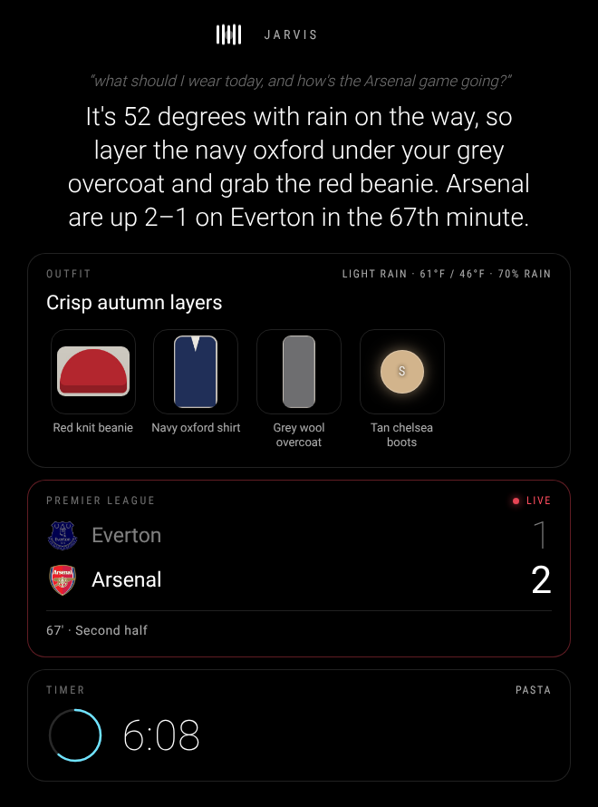

# MMM-AI-Jarvis

A private, voice-controlled assistant and personal stylist for [MagicMirror²](https://magicmirror.builders/).
Talk to your mirror, and Jarvis answers out loud and puts things on the screen: live sports scores,
timers, lists, and outfits picked from **your own wardrobe** for today's weather. It can see you
through a camera, remember your clothes and your preferences, and show, hide or rearrange the other
modules on your mirror.

**Everything runs on your own hardware.** Speech recognition, the language and vision model, and the
voice are all local. There are no cloud accounts, no API keys and no usage bills, and your camera
images never leave the house.

<p align="center"></p>

---

## Contents

- [Features](#features)
- [How it works](#how-it-works)
- [Hardware](#hardware)
- [Installation](#installation)
- [Things to say](#things-to-say)
- [Building your wardrobe](#building-your-wardrobe)
- [Controlling the mirror](#controlling-the-mirror)
- [Configuration](#configuration)
- [Running the model on another computer](#running-the-model-on-another-computer)
- [Notifications API](#notifications-api)
- [Privacy](#privacy)
- [Troubleshooting](#troubleshooting)
- [Upgrading from v2](#upgrading-from-v2)
- [Development](#development)

---

## Features

| | |
|---|---|
| 🎙️ **Hands-free voice** | Wake word ("Jarvis…"), follow-up questions without repeating it, "stop" to interrupt |
| 👗 **Wardrobe memory** | Hold clothes up to the mirror and say "add this to my wardrobe". Jarvis photographs, names and catalogues them |
| 🌦️ **Outfit planning** | "What should I wear today?" picks a coordinated outfit from your wardrobe based on the weather, the occasion, what you wore recently and what you like |
| 👀 **Vision** | "How do I look?" / "Does this match?" gets honest feedback from the camera |
| 🏆 **Live scores** | "What's the score of the Arsenal game?" pins a scoreboard that updates live (NFL, NBA, MLB, NHL, Premier League, Champions League, MLS and more) |
| ⏱️ **Timers** | "Set a pasta timer for 10 minutes" shows a countdown and announces when it's done |
| 🪞 **Screen control** | "Hide the news", "show the calendar", "focus mode", "clear the screen", plus your own voice commands for any module |
| 📋 **Info panels** | Ask for a list, steps or a summary and Jarvis puts it on screen |
| 🧠 **Long-term memory** | "Remember that my office is business casual" is kept across restarts and used in every answer |
| 🔒 **100% local** | whisper.cpp + Ollama + Piper. No cloud, no keys |

## How it works

```
 microphone ─► voice activity detection ─► whisper.cpp ─► wake word ─┐
                (only speech is transcribed)  (speech-to-text)        │
                                                                      ▼
                                       ┌──────────── fast intents (scores, timers, outfits,
                                       │             screen control, memory) – no LLM needed
                                       ▼
                                 Ollama (qwen3.5) ◄── tools: camera, wardrobe, weather,
                                 language + vision        scores, timers, screen, memory
                                       │
              mirror UI ◄── live cards ┤
              speaker   ◄── Piper ◄────┘
```

- **Voice activity detection** cuts the microphone stream into sentences locally, so the speech
  recogniser only runs when someone is talking. It adapts to room noise and ignores fans and hums.
- **Fast intents** handle the most common requests (scores, timers, outfits, camera, screen
  control, memory, "put … on the mirror") directly or with a single structured model call. Small
  local models sometimes pick the wrong tool or claim they did something they didn't, so the
  important paths don't depend on free tool choice. Everything else goes to the LLM, which can
  call the same tools.
- **Live cards** (scores, timers, outfits, info panels) are managed on the server and refresh on
  their own. A live game updates every 20 seconds, and the score animates when someone scores.

## Hardware

| Setup | Model | Notes |
|---|---|---|
| **Raspberry Pi 5, 8 GB** (recommended) | `qwen3.5:4b` | Everything on the mirror. Use active cooling: the LLM keeps all cores busy while it thinks |
| Raspberry Pi 5, 4 GB | `qwen3.5:2b` | Works; answers are a little less clever |
| Raspberry Pi 4, 8 GB | `qwen3.5:2b` | Usable, but noticeably slower for LLM answers |
| Pi + a PC/Mac on your network | `qwen3.5:9b` or larger | Fastest and smartest. See [Running the model on another computer](#running-the-model-on-another-computer) |

`qwen3.5:2b` is the smallest model recommended. In testing, `qwen3.5:0.8b` sometimes claimed to have
done things (like saving a preference) without actually calling the tool.

**What to expect.** These timings were measured end to end inside MagicMirror 2.38 on a 4-core x86
test VM with **no GPU**, running `qwen3.5:2b`. A Raspberry Pi 5 will be slower; a PC with a GPU is
much faster.

| Request | Path | Time |
|---|---|---|
| Speech recognition (whisper.cpp `base.en`, short command) | – | ~1.3 s |
| Voice (Piper server, per sentence) | – | 0.1–0.4 s |
| "What's the score of the Pistons game?" / timers / "hide the news" | fast intent | ~0.2 s |
| "Put a packing list for the beach on the mirror" | structured panel | ~14 s |
| "What should I wear today?" | outfit planner | ~15–17 s |
| Open questions ("a good stretch for a stiff neck?") | LLM + tools | ~35–45 s |
| "How do I look?" | vision | ~35 s |
| "Add these clothes to my wardrobe" (3 items, 960×720 photo) | vision + cataloguing | ~60 s |

If you want snappier answers, [offloading the model](#running-the-model-on-another-computer) to a
faster machine makes the biggest difference. Scores, timers and screen control stay instant either
way.

You'll also need:

- **64-bit OS**: Raspberry Pi OS (Bookworm or newer) or Debian/Ubuntu
- **MagicMirror² 2.20 or newer** (tested against **v2.38.0**, which requires Node.js ≥ 22.22.2)
- **A USB microphone**; a conference-style mic works best from across a room
- **A speaker** (USB, 3.5 mm or HDMI audio)
- **A camera** (optional, for vision and wardrobe): the Raspberry Pi Camera Module or any USB webcam

## Installation

### 1. Get the module

```bash
cd ~/MagicMirror/modules
git clone https://github.com/RedNetty/MMM-AI-Jarvis.git
```

Jarvis has **no npm dependencies**, so there's no `npm install` step.

### 2. Install the local AI stack

The setup script installs and configures everything (Ollama with a model sized to your RAM,
whisper.cpp and Piper as background services, plus the audio and camera tools):

```bash
cd ~/MagicMirror/modules/MMM-AI-Jarvis
scripts/setup-pi.sh
```

It takes a while on first run (it compiles whisper.cpp and downloads a few GB of models). At the end
it plays a test phrase and prints the config block to paste. Options:

```bash
scripts/setup-pi.sh --model qwen3.5:2b        # pick a different model
scripts/setup-pi.sh --voice en_US-lessac-medium  # pick a different voice (listen at https://rhasspy.github.io/piper-samples/)
scripts/setup-pi.sh --whisper-model base      # multilingual speech recognition (base.en is English-only)
scripts/setup-pi.sh --no-ollama               # if the model runs on another computer
```

<details>
<summary><b>Manual installation (what the script does)</b></summary>

```bash
# System tools
sudo apt install alsa-utils espeak-ng fswebcam curl zstd git cmake build-essential python3-venv

# Ollama + model
curl -fsSL https://ollama.com/install.sh | sh
ollama pull qwen3.5:4b

# whisper.cpp server on port 8178 (MagicMirror already uses 8080)
git clone --depth 1 https://github.com/ggml-org/whisper.cpp.git ~/.local/share/jarvis/whisper.cpp
cd ~/.local/share/jarvis/whisper.cpp
cmake -B build -DCMAKE_BUILD_TYPE=Release && cmake --build build -j --target whisper-server
bash models/download-ggml-model.sh base.en
./build/bin/whisper-server -m models/ggml-base.en.bin --host 127.0.0.1 --port 8178

# Piper voice server on port 5005
python3 -m venv ~/.local/share/jarvis/piper-venv
~/.local/share/jarvis/piper-venv/bin/pip install "piper-tts[http]"
mkdir -p ~/.local/share/jarvis/voices && cd ~/.local/share/jarvis/voices
curl -LO https://huggingface.co/rhasspy/piper-voices/resolve/main/en/en_GB/alan/medium/en_GB-alan-medium.onnx
curl -LO https://huggingface.co/rhasspy/piper-voices/resolve/main/en/en_GB/alan/medium/en_GB-alan-medium.onnx.json
~/.local/share/jarvis/piper-venv/bin/python -m piper.http_server -m en_GB-alan-medium.onnx --host 127.0.0.1 --port 5005
```

The script also installs `jarvis-whisper` and `jarvis-piper` systemd services so both servers start
at boot, and limits Ollama to one loaded model to keep RAM use predictable.
</details>

### 3. Add it to your config

In `~/MagicMirror/config/config.js`:

```js
{
  module: "MMM-AI-Jarvis",
  position: "lower_third",
  config: {
    userName: "Alex",
    llm: { model: "qwen3.5:4b" },
  },
},
```

That's all most people need; the defaults match the setup script. Restart MagicMirror and say
**"Jarvis, what should I wear today?"**

If something isn't running, Jarvis shows the problem in amber on the mirror (for example
*"Cannot reach Ollama…"*) and keeps re-checking, so services that start after MagicMirror at boot
are picked up automatically.

## Things to say

Start with the wake word, then ask. After an answer, you have a few seconds to follow up **without**
the wake word ("…and something warmer?"). Say **"stop"** to interrupt.

**Style & wardrobe**
- "Jarvis, what should I wear today?" · "…for a job interview tomorrow?" · "something warmer"
- "How do I look?" · "Does this go together?" · "What am I wearing?"
- "Add this jacket to my wardrobe" (hold it up to the mirror)
- "Add my black leather boots to my wardrobe" (by voice, no photo)
- "Show me my blue tops" · "Remove the grey hoodie from my wardrobe"
- "I'm wearing that" (logs the suggested outfit so it isn't repeated tomorrow)

**On the screen**
- "What's the score of the Lakers game?" · "Did the Yankees win?" · "When do Arsenal play?"
- "Set a pasta timer for 12 minutes" · "How much time is left?" · "Cancel the timer"
- "Put a packing list for the beach on the mirror"
- "Hide the news" · "Show the calendar" · "Focus mode" · "Bring back everything" · "Close that"

**Memory & everything else**
- "Remember that my office is business casual" · "Forget that I hate yellow"
- "What's the weather tomorrow?" · "Tell me a joke" · anything you'd ask an assistant

## Building your wardrobe

1. Stand in front of the mirror in good light.
2. Hold one or a few items up to the camera and say **"Jarvis, add these to my wardrobe."**
3. Jarvis photographs them, identifies each piece (name, category, colours, material, formality,
   warmth and season) and shows them on screen, cropped from the photo.

Tips:
- One to three items per photo works best, held flat against a plain background.
- You can correct anything by voice: "Change the grey hoodie to warmth 4".
- Shoes and accessories count too. Outfits are better when Jarvis knows your shoes.
- Say "I'm wearing that" after a suggestion. Jarvis avoids repeating recently worn pieces.

Your wardrobe lives in `data/wardrobe.json` (plus photos in `data/photos/`). It's plain JSON you can
back up or edit.

## Controlling the mirror

Jarvis knows which modules are on your mirror, so you can refer to them naturally ("the news",
"the calendar", "the weather", "top left"). It hides and shows them through MagicMirror's own
lock mechanism, so it never fights page-switching modules like MMM-pages. A module hidden by
something else stays hidden.

**Auto-hide:** modules listed in `display.autoHide` (by default `compliments`, which shares the lower
third) fade out while Jarvis is talking or showing a card, and come back afterwards.

**Your own voice commands:** map any phrase to a MagicMirror notification to drive other modules:

```js
customCommands: [
  { phrases: ["next page"], notification: "PAGE_INCREMENT", reply: "Next page." },      // MMM-pages
  { phrases: ["previous page"], notification: "PAGE_DECREMENT", reply: "Going back." },
  { phrases: ["screen off"], notification: "REMOTE_ACTION", payload: { action: "MONITOROFF" } }, // MMM-Remote-Control
],
```

## Configuration

Every option is optional. Nested sections merge with the defaults, so `llm: { model: "qwen3.5:2b" }`
keeps every other `llm` setting. See [`config/config.js.sample`](config/config.js.sample) for a
fully commented copy.

<details open>
<summary><b>General</b></summary>

| Option | Default | Description |
|---|---|---|
| `assistantName` | `"Jarvis"` | Name used on screen and in replies |
| `wakeWord` | `"jarvis"` | Word that starts a request |
| `wakeWordAliases` | `["jervis","jarvus","javis"]` | Mis-hearings that also count |
| `userName` | `""` | Personalises replies |
| `language` | `"en"` | Speech recognition language (`de`, `fr`, `es`…; needs a multilingual Whisper model) |
| `locale` / `units` | MagicMirror's | Date format and metric/imperial |
| `dataDir` | `"data"` | Where wardrobe, memory and photos are stored |
| `customCommands` | `[]` | Phrase → notification mappings (see above) |
| `debug` | `false` | Log transcripts and timings |
</details>

<details>
<summary><b>stt</b> – speech recognition</summary>

| Option | Default | Description |
|---|---|---|
| `whisperUrl` | `"http://127.0.0.1:8178"` | whisper.cpp server |
</details>

<details>
<summary><b>tts</b> – voice</summary>

| Option | Default | Description |
|---|---|---|
| `provider` | `"piper"` | `"piper"` or `"espeak"` (robotic but needs no setup) |
| `piperUrl` | `"http://127.0.0.1:5005"` | Piper voice server (keeps the voice loaded, ~0.2 s per sentence) |
| `piperCommand` / `piperModel` | setup-script paths | Piper CLI fallback, used automatically if the server is down |
| `piperSpeaker` | `null` | Speaker id for multi-speaker voices |
| `piperLengthScale` | `null` | Speaking speed (`0.9` faster, `1.1` slower) |
| `espeakVoice` / `espeakSpeed` | `"en-us"` / `165` | espeak-ng settings |

If Piper isn't reachable at all, Jarvis falls back to espeak-ng and says so on the mirror.
</details>

<details>
<summary><b>llm</b> – language & vision model</summary>

| Option | Default | Description |
|---|---|---|
| `ollamaUrl` | `"http://127.0.0.1:11434"` | Ollama server (can be another computer) |
| `model` | `"qwen3.5:4b"` | Any Ollama model. Use one with *tools* and *vision* for all features |
| `visionModel` | `""` | Separate model for camera images (empty = `model`) |
| `keepAlive` | `"30m"` | How long the model stays loaded (`-1` = forever) |
| `temperature` / `maxTokens` / `contextSize` | `0.6` / `400` / `8192` | Generation settings |
| `think` | `false` | Let "thinking" models reason first (smarter, slower) |
| `fastIntents` | `true` | Handle common requests without the LLM |
</details>

<details>
<summary><b>audio</b> – microphone & speaker</summary>

| Option | Default | Description |
|---|---|---|
| `micDevice` | `"default"` | ALSA capture device (`arecord -L`), e.g. `"plughw:1,0"`. `"none"` disables the mic |
| `speakerDevice` | `"default"` | ALSA playback device (`aplay -L`) |
| `vadThreshold` | `500` | Minimum loudness counted as speech; raise it if noise triggers Jarvis |
| `noiseMultiplier` | `3` | Speech must be this many times louder than the room |
| `silenceMs` | `900` | Pause that ends a sentence |
| `preRollMs` / `minUtteranceMs` / `maxUtteranceMs` | `400` / `350` / `15000` | Utterance shaping |
| `allowBargeIn` | `true` | Listen while speaking so "stop" works; set `false` if Jarvis hears itself |
| `chime` / `chimeVolume` | `true` / `0.25` | Tone when you say just the wake word |
</details>

<details>
<summary><b>camera</b></summary>

| Option | Default | Description |
|---|---|---|
| `enabled` | `true` | Turn vision features on/off |
| `tool` | `"auto"` | `rpicam-still`, `libcamera-still`, `fswebcam`, `ffmpeg`, `custom`, or `auto` |
| `device` | `"/dev/video0"` | USB webcam device |
| `width` / `height` | `960` / `720` | Photo size. Bigger photos make vision noticeably slower (1280×960 took ~1.8× as long in testing) |
| `rotation` / `flip` | `0` / `false` | `180` for an upside-down camera; `flip` mirrors horizontally |
| `warmupMs` | `1200` | Time for auto-exposure to settle |
| `customCommand` | `[]` | For `tool: "custom"`: a command that writes a JPEG to stdout (`{width}`, `{height}`, `{device}` are filled in) |
</details>

<details>
<summary><b>weather</b>, <b>sports</b>, <b>search</b></summary>

| Option | Default | Description |
|---|---|---|
| `weather.latitude` / `longitude` | `null` | Set to fetch from Open-Meteo (free, no key). Leave `null` to reuse MagicMirror's weather module |
| `weather.locationName` | `""` | Shown in answers when using coordinates |
| `sports.enabled` | `true` | Live scores from ESPN's public feed (no key) |
| `sports.leagues` | NFL, NBA, MLB, NHL, EPL, MLS, UCL, LaLiga, Bundesliga, Serie A | Searched when you don't name a league. Also available: `ncaaf`, `wnba`, `ncaab`, `championship`, `ligue1`, `uel` |
| `search.searxngUrl` | `""` | Optional self-hosted [SearXNG](https://docs.searxng.org) for web answers (enable the `json` format in its settings) |

Outfit suggestions need weather data. Easiest is MagicMirror's built-in `weather` module (any
provider; `openmeteo` needs no key), which Jarvis listens to automatically.
</details>

<details>
<summary><b>conversation</b> & <b>display</b></summary>

| Option | Default | Description |
|---|---|---|
| `conversation.listenTimeout` | `8000` | After the bare wake word, how long to wait for the question |
| `conversation.followUpWindow` | `8000` | Reply without the wake word for this long after an answer (`0` = off) |
| `conversation.historyTurns` | `6` | Exchanges remembered within a conversation |
| `conversation.resetAfter` | `300000` | Start fresh after this long idle |
| `display.showTranscription` / `showResponse` | `true` | Show what you said / what Jarvis said |
| `display.clearAfter` | `30000` | Fade the conversation after this long idle |
| `display.maxWidgets` | `4` | Cards on screen at once (running timers are never dropped) |
| `display.cardTimeout` / `infoTimeout` / `snapshotTimeout` | `90000` / `180000` / `8000` | Card lifetimes |
| `display.autoHide` | `["compliments"]` | Modules faded out while Jarvis is active |
| `display.showProblems` | `true` | Show setup problems on the mirror |
</details>

## Running the model on another computer

The language model is the slowest part on a Pi. Any Mac, Windows or Linux PC on your network can run
it instead, and a gaming GPU makes answers near-instant.

1. Install [Ollama](https://ollama.com/download) on the PC and pull a model: `ollama pull qwen3.5:9b`
2. Let it accept network connections by setting the environment variable `OLLAMA_HOST=0.0.0.0` and
   restarting Ollama ([how](https://github.com/ollama/ollama/blob/main/docs/faq.md#how-do-i-configure-ollama-server)).
3. Point Jarvis at it:
   ```js
   llm: { ollamaUrl: "http://192.168.1.50:11434", model: "qwen3.5:9b" },
   ```
4. Run `scripts/setup-pi.sh --no-ollama` on the Pi.

Speech recognition and the voice stay on the Pi; they're light enough.

## Notifications API

Other modules (or MMM-Remote-Control) can drive Jarvis:

| Send | Payload | Effect |
|---|---|---|
| `JARVIS_ASK` | `"text"` or `{ text }` | Ask a question as if spoken (no wake word needed) |
| `JARVIS_STOP` | – | Stop talking / cancel |

Jarvis broadcasts:

| Notification | Payload |
|---|---|
| `JARVIS_STATE` | `{ state }`: `idle`, `listening`, `processing`, `speaking` |
| `JARVIS_RESPONSE` | `{ text }`: every answer |
| `JARVIS_TIMER_DONE` | `{ label }` |

Example: show a daily outfit at 7:30 with [MMM-ModuleScheduler](https://github.com/ianperrin/MMM-ModuleScheduler)'s
`notification_schedule` sending `JARVIS_ASK` with `"What should I wear today?"`.

## Privacy

- **Audio** is processed in memory. Nothing is recorded to disk, and only speech after the voice
  detector triggers is transcribed, all locally.
- **The camera** is only used when you ask something that needs it. Snapshots for "how do I look"
  are kept in memory and shown briefly; only photos of clothing you add to your wardrobe are saved
  (`data/photos/`).
- **No cloud services** are used for any of this. The only outbound requests are the optional sports
  scores (ESPN), weather (Open-Meteo, only if you set coordinates) and web search (your own SearXNG).
- Delete `data/` to wipe everything Jarvis knows.

## Troubleshooting

| Problem | Fix |
|---|---|
| Amber "Cannot reach Ollama" | `systemctl status ollama`; check `llm.ollamaUrl` |
| "Ollama model … is not installed" | `ollama pull <model>` |
| "Cannot reach the whisper.cpp server" | `systemctl status jarvis-whisper` / `journalctl -u jarvis-whisper` |
| Robotic voice | Piper isn't running (`systemctl status jarvis-piper`); Jarvis fell back to espeak-ng |
| Jarvis never hears you | Find your mic with `arecord -l`, set `audio.micDevice: "plughw:CARD,0"`, test with `arecord -D plughw:1,0 -f S16_LE -r 16000 test.wav` |
| Jarvis triggers on background noise | Raise `audio.vadThreshold` (e.g. 900); turn on `debug` to see what it hears |
| Jarvis responds to its own voice | Set `audio.allowBargeIn: false`, or move the mic away from the speaker |
| No sound | `aplay -l`, then set `audio.speakerDevice`; test with `speaker-test -t wav -c 2` |
| Wake word misheard | Add the mis-hearing to `wakeWordAliases` (turn on `debug` to see transcripts) |
| "Camera … no capture tool found" | Pi camera: `rpicam-still --list-cameras`. USB: `sudo apt install fswebcam` |
| Outfits ignore the weather | Add MagicMirror's `weather` module or set `weather.latitude/longitude` |
| Slow answers | Use a smaller model, keep `fastIntents: true`, or run the model on another computer |

## Upgrading from v2

Version 3 replaces Google Cloud (Speech, TTS, Vertex AI) with local models. Google retired the
`gemini-1.5` models and the Vertex AI SDK that v2 used, so v2 no longer works.

1. Run `scripts/setup-pi.sh`.
2. Remove `projectId`, `location`, `model`, `serviceAccountFile`, `ttsVoice` and `speechLanguage`
   from your config (they're ignored, with a warning). `activationKeyword`, `showTranscription`,
   `showResponse`, `responseTimeout` and `maxTokens` still work and are mapped to the new options.
3. Delete `credentials.json` and the old `node_modules/`; v3 has no npm dependencies.

## Development

```bash
npm test          # node:test suite – no MagicMirror, models or hardware needed
```

```
MMM-AI-Jarvis/
├── MMM-AI-Jarvis.js        # Front-end: status orb, conversation, live cards, module control
├── MMM-AI-Jarvis.css       # Mirror-friendly styles (rem-based, follows MagicMirror's type scale)
├── node_helper.js          # Bridge between the mirror and the engine; serves wardrobe photos
├── lib/
│   ├── Jarvis.js           # Orchestrator: mic → VAD → STT → wake word → assistant → TTS
│   ├── Assistant.js        # Conversation, system prompt, fast intents, LLM tool loop
│   ├── intents.js          # Deterministic routing for common requests
│   ├── tools.js            # Tool definitions exposed to the LLM
│   ├── Skills.js           # Everything Jarvis can do (vision, outfits, scores, timers, screen…)
│   ├── Widgets.js          # Live cards with expiry and self-refresh
│   ├── Screen.js           # Knows and controls other modules on the mirror
│   ├── Sports.js           # ESPN public scoreboards
│   ├── Ollama.js           # Local LLM client (capability-aware)
│   ├── Wardrobe.js, Memory.js, JsonStore.js
│   ├── Weather.js, Camera.js, WebSearch.js
│   ├── audio/              # Microphone, voice activity detector, speaker, WAV/chime
│   ├── stt/                # whisper.cpp client
│   └── tts/                # Piper (server + CLI) and espeak-ng
├── scripts/setup-pi.sh     # Installs the local AI stack
├── config/config.js.sample
└── test/
```

## License

MIT
